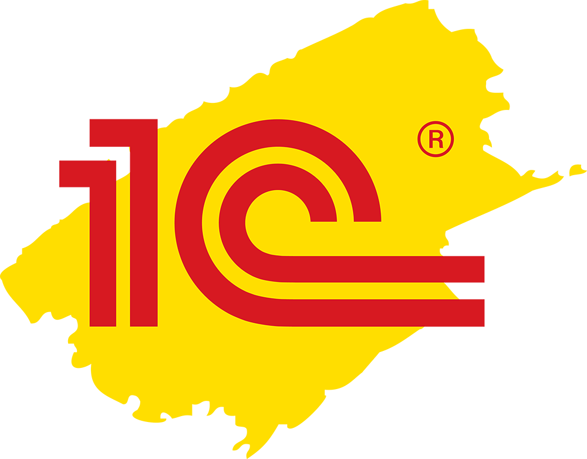
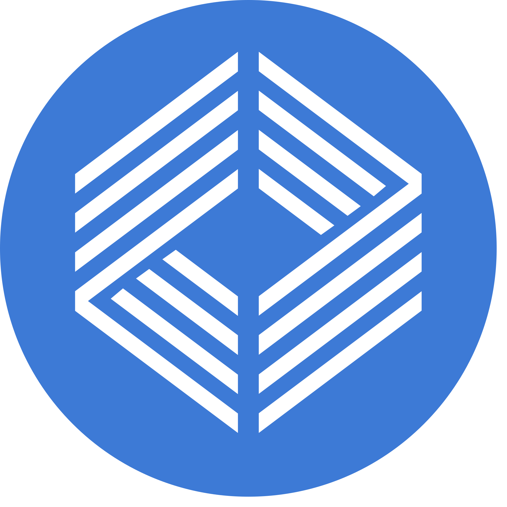

# Карло Иван - архитектор 1С

  

   

Работаю на полной занятности

Люблю исследовать новые технологии

## Мои инструменты

<table>
  <tr>
    <td></td>
    <td></td>
    <td></td>
    <td></td>
    <td></td>
    <td></td>
    <td></td>
  </tr>
  <tr>
    <td></td>
    <td></td>
    <td></td>
    <td></td>
    <td></td>
    <td></td>
    <td></td>
  </tr>
  <tr>
    <td></td>
    <td></td>
    <td></td>
    <td></td>
    <td></td>
    <td></td>
    <td></td>
  </tr>
</table>

  
  

<!-- CONTRIBUTED_REPOS_START -->

| Репозиторий | Описание | ⭐ | Язык |
|-------------|----------|----|------|
| [yellow-hammer/vscode-1c-platform-tools](https://github.com/yellow-hammer/vscode-1c-platform-tools) | Расширение Visual Studio Code (Cursor, Windsurf, V... | 237 | TypeScript |
| [yellow-hammer/md-sparrow](https://github.com/yellow-hammer/md-sparrow) | Чтение и запись метаданных 1С:Предприятие 8 в форм... | 24 | Java |
| [yellow-hammer/dev-rules](https://github.com/yellow-hammer/dev-rules) | Обыкновенные стандарты разработки на платформе 1С:... | 61 | JavaScript |
| [yellow-hammer/mcp-1c-platform-tools](https://github.com/yellow-hammer/mcp-1c-platform-tools) | MCP-сервер расширения 1C: Platform Tools для AI-аг... | 42 | TypeScript |
| [1c-syntax/bsl-language-server](https://github.com/1c-syntax/bsl-language-server) | Реализация Language Server Protocol для языка 1C (... | 496 | Java |
| [vanessa-opensource/vanessa-runner](https://github.com/vanessa-opensource/vanessa-runner) | утилита автоматизации базовых операций разработчик... | 281 | 1C Enterprise |
| [yellow-hammer/onec-debug-adapter](https://github.com/yellow-hammer/onec-debug-adapter) | Debug Adapter Protocol client implementation for 1... | 13 | C# |
| [1c-syntax/mdclasses](https://github.com/1c-syntax/mdclasses) | Разбор метаданных конфигураций, расширений и т.д. ... | 67 | Java |
| [firstBitMarksistskaya/jenkins-lib](https://github.com/firstBitMarksistskaya/jenkins-lib) | Jenkins shared library для 1С:Предприятие 8 | 215 | Groovy |
| [yellow-hammer/prometheus-e1c](https://github.com/yellow-hammer/prometheus-e1c) | Расширение 1С:Предприятие 8 для экспорта метрик в ... | 22 | 1C Enterprise |
| [nixel2007/opentelemetry-v8-logs](https://github.com/nixel2007/opentelemetry-v8-logs) | Без описания | 10 | 1C Enterprise |
| [yellow-hammer/namespace-forest](https://github.com/yellow-hammer/namespace-forest) | Схемы форматов исходников 1С:Предприятие 8: XSD вы... | 16 | 1C Enterprise |
| [yellow-hammer/oneflag](https://github.com/yellow-hammer/oneflag) | Self-hosted сервис фича-флагов: дашборд, REST API,... | 11 | 1C Enterprise |
| [yellow-hammer/vscode-1c-platform-extension-pack](https://github.com/yellow-hammer/vscode-1c-platform-extension-pack) | Набор расширений Visual Studio Code (Cursor, Winds... | 27 | N/A |
| [infina15/oproxy](https://github.com/infina15/oproxy) | TCP прокси-сервер хранилища конфигураций 1С | 77 | 1C Enterprise |
| [yellow-hammer/prometheus](https://github.com/yellow-hammer/prometheus) | Клиент Prometheus для OneScript: счётчики, индикат... | 12 | 1C Enterprise |
| [zerobig/vscode-1c-metadata-viewer](https://github.com/zerobig/vscode-1c-metadata-viewer) | Вывод дерева метаданных конфигурации 1С и открытие... | 266 | TypeScript |
| [akpaevj/onec-debug-adapter](https://github.com/akpaevj/onec-debug-adapter) | Без описания | 91 | C# |
| [autumn-library/autumn-library.github.io](https://github.com/autumn-library/autumn-library.github.io) | Без описания | 6 | TypeScript |
| [cpr1c/tools_ui_1c](https://github.com/cpr1c/tools_ui_1c) | Универсальные инструменты 1С для управляемых форм | 1148 | 1C Enterprise |
| [EvilBeaver/OneScript](https://github.com/EvilBeaver/OneScript) | Исполняющая среда скриптов на языке 1С | 588 | C# |
| [oscript-library/opm](https://github.com/oscript-library/opm) | Пакетный менеджер OneScript | 86 | 1C Enterprise |
| [zerobig/swagger-1c](https://github.com/zerobig/swagger-1c) | Документация HTTP сервисов в 1С при помощи swagger | 117 | 1C Enterprise |
| [1c-syntax/vsc-language-1c-bsl](https://github.com/1c-syntax/vsc-language-1c-bsl) | Syntax definition rules for 1C:Enterprise 8 in VSC | 195 | TypeScript |
| [Nivanchenko/bootstrapper](https://github.com/Nivanchenko/bootstrapper) | Многофункциональный набор инструментов для 1С разр... | 106 | CSS |

<!-- CONTRIBUTED_REPOS_END -->

## 🫶 Поставьте 🌟🌟🌟 какому-нибудь репозиторию 🫶

  

